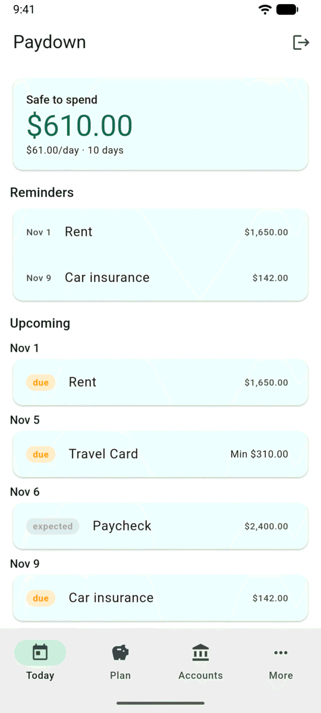
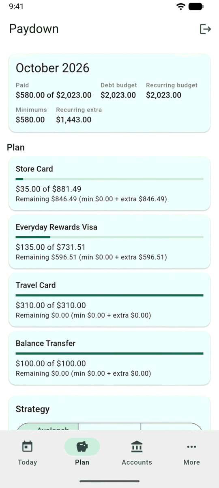
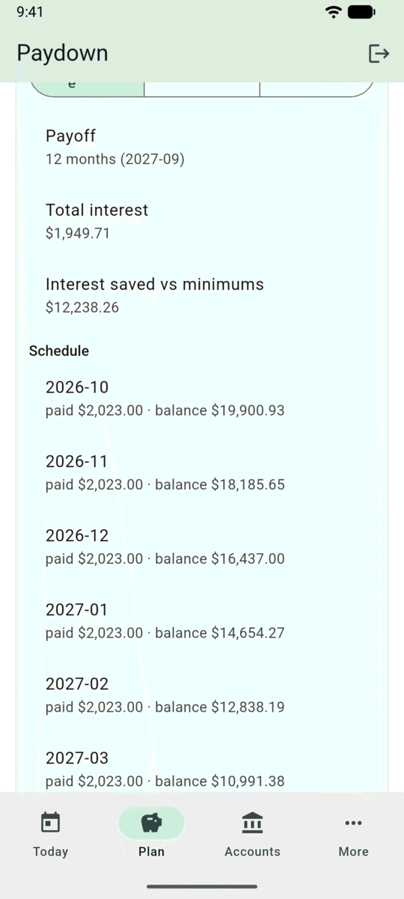
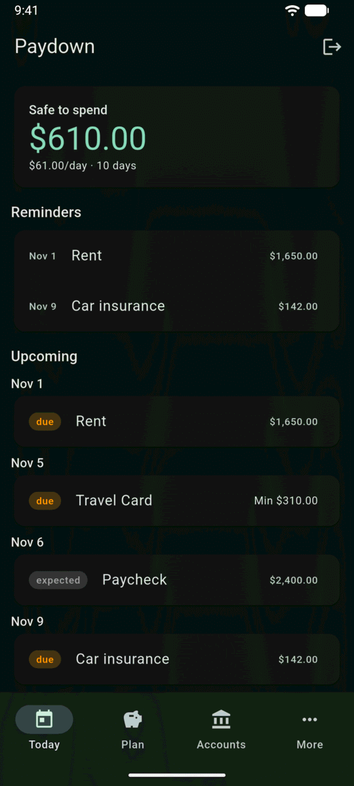
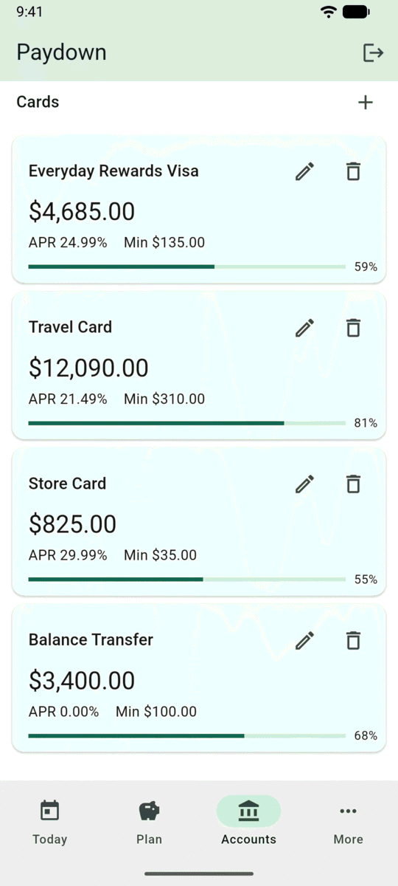
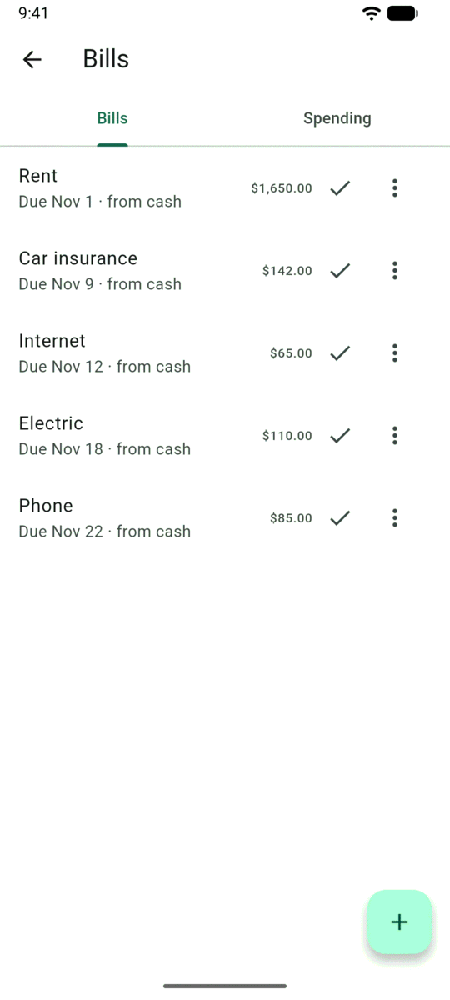
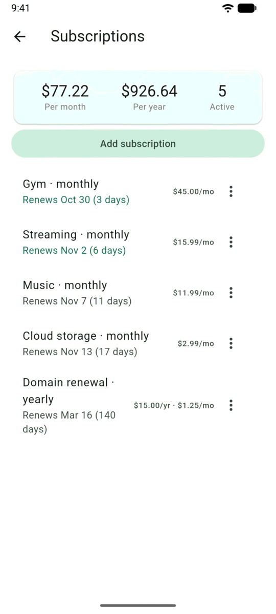
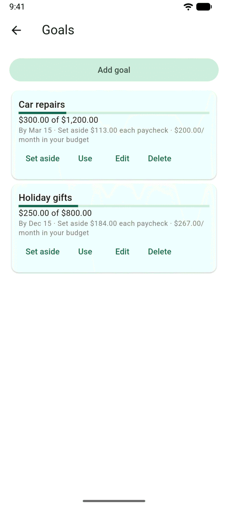

#  Paydown for Android

A native Android client for [Paydown](https://github.com/jcrabapple/paydown), the self-hosted credit-card payoff and **Safe-to-Spend** budget app. Built with Flutter.

The app is a client only. It needs a running Paydown server (yours), and talks to it over the same JSON API the web app uses, with the same HTTP Basic credentials.

<p align="center">
  
  
  
  
</p>
<p align="center">
  
  
  
  
</p>
<p align="center"><sub>Screenshots use the fictional demo household from the server repo's <code>scripts/seed_demo.py</code>.</sub></p>

## Features

Full parity with the web app's day-to-day flows:

- **Today**: Safe-to-Spend hero with the full waterfall, reminders, upcoming bills and card payments (minimum vs. planned extra shown separately), and logging card payments your bank already made.
- **Plan**: this month's per-card plan, Avalanche / Snowball / Custom projections, sweeping spare cash into the plan, one-off adjustments.
- **Accounts**: cash accounts, cards (with APR and minimum overrides for bank-synced cards), and Plaid bank connections via the native Plaid Link SDK.
- **More**: bills and spending, payments by month, subscriptions (including ones detected from your transactions), sinking-fund goals, insights (net debt trend, spending baseline), and settings (strategy, buffer, cash floor, income, pay schedules, deposit rules).
- Light, dark, or follow-the-system theme.

## Requirements

- A Paydown server reachable from your phone over **HTTPS** (for example behind a reverse proxy or a Cloudflare Tunnel). See the [server README](https://github.com/jcrabapple/paydown#readme).
- Android 7.0+ (API 24).
- To build: Flutter 3.47+ and JDK 17 (Android Studio's bundled JBR works).

## Build and install

```bash
git clone https://github.com/jcrabapple/paydown-android.git
cd paydown-android
flutter pub get
flutter build apk --release
adb install -r build/app/outputs/flutter-apk/app-release.apk
```

On first launch, enter your server address (e.g. `https://budget.example.com`), user and password. Credentials are verified against the server before anything is saved, then kept in Android's encrypted storage (`flutter_secure_storage`). They are never logged. There is no default server.

### Release signing

Without configuration, release builds are signed with the debug key, which is fine for installing on your own phone. To sign with your own key, create `android/key.properties` (git-ignored):

```properties
storeFile=/absolute/path/to/your-release.jks
storePassword=...
keyAlias=...
keyPassword=...
```

Keep that keystore safe: an installed app only accepts updates signed with the same key.

## Bank connections (Plaid)

Connecting a bank from the phone uses Plaid's native Link SDK, so Plaid has to know about the app:

1. In the Plaid dashboard, register the app's package name (`us.snakepit.paydown`, or your own if you forked it) with the **SHA-256 of the certificate that signs your APK**.
2. The server must have Plaid configured (see the server README).

If you change `applicationId` in `android/app/build.gradle.kts`, also update `kAndroidPackageName` in `lib/screens/accounts.dart`. You can also connect banks from the web app; the phone shows them either way.

## Development

```bash
flutter analyze
flutter test
```

- To try the app without real data, seed the server's demo household (`uv run python scripts/seed_demo.py data/demo.db` in the server repo) and point a debug build at it. Debug and profile builds allow plain `http` (e.g. `http://10.0.2.2:8485` from the emulator); release builds require https.
- Screens are tested against **real (scrubbed) server responses** in `docs/fixtures/`.
- Every request the test suite sends is validated against the server's OpenAPI schema (`docs/openapi.json`, enforced by `test/contract.dart`): a wrong route, a missing required field, an unknown field, or a wrong JSON type fails the test that sent it. Regenerate the schema whenever the server's models change (command in `docs/ANDROID1.md`, "Contract schema").
- Design decisions and per-screen endpoint contracts: `docs/ANDROID1.md`. Server-side mobile contract: the server repo's `docs/API1.md`.

There is no state-management package. Each screen is a `StatefulWidget` that fetches its own data, refetches after its own mutations, and supports pull-to-refresh. Errors stay on screen until dismissed; only success messages auto-hide.

Security issues: see [SECURITY.md](SECURITY.md).

## License

[MIT](LICENSE)
